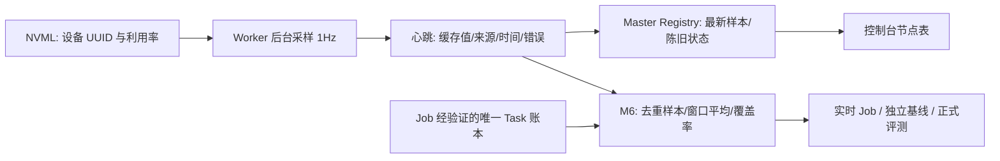

# GPU 采样与评测指标修复工作流

1. G1：GPU 采样包、实际设备 UUID/PCI、后台采样与缺失原因可观测；心跳不执行阻塞探测。
2. G2：样本及时间戳经心跳到 Master、前端；0% 与未知/过期区分，平均值限定测量窗口并报告覆盖率。
3. G3：Job 实时有效吞吐与正式单机基线分开；运行中不计算伪造的 S/η，Task 只计一次。
4. G4：独立预热、各设备独立基线、固定参与集合的池测量；绑定相同输入、任务类型、分片、模型及执行配置。
5. G5：前端展示公式、单位、来源 Job、窗口、设备集合、基线及复核原因，不混用历史样本。
6. G6：数值金样、不可比/缺失/重复/跨 Job 测试，以及真实 GPU 采样、CPU 与 GPU 双端回归。

题面公式：P_i=N_i/T_i（各设备独立测量）；P_pool=N_pool/T_pool；
η=P_pool/ΣP_i×100%；S=P_pool/max(P_i)。单位统一为验证后图片/秒。
正式测量使用相同服务入口，Task 唯一确认计数，完整 Job 的提交至结果聚合可用为窗口。
失败重试耗时保留在分母，重复/失败工作量不进入分子。运行中吞吐只作运行反馈。
GPU% 是设备采样周期中的繁忙时间比例，不是 FLOPS 利用率，不等于显存占用比例。

## 数据链路与修复



GPU 名称能显示，不代表利用率链路可用。原环境没有 `pynvml`，因此 `gpu_pct` 一直是 null；
现在 GPU 依赖清单包含 NVIDIA `nvidia-ml-py`，实际设备 UUID/PCI 来自执行器，避免固定索引选错卡。
前端区分“等待采样 / 不可用 / 采样过期 / 离线”和真正的 `0.0%`，悬停显示来源、设备和原因。
整卡数值包含桌面和其他进程，不能当作 DormPool 独占 GPU 百分比。
NVML 返回的是硬件采样周期内的繁忙比例，应用以 1Hz 读取；短时间突发推理不一定显示 100%。
[NVML 利用率定义](https://docs.nvidia.com/deploy/archive/R515/nvml-api/structnvmlUtilization__t.html)。

原 `P_i` 来自所有历史 Attempt 的占用跨度，并未独立测量，且会混入其他 Job/任务类型；现已取消其正式基线身份。
原 `P_pool` 只在 Job 结束时产生，但缺失时用 0 计算 S/η，前端又把 0 显示为“—”，造成截图中互相矛盾的指标。
现在实时吞吐按选定 Job 的唯一有效图片账本计算；正式 S/η 只来自冻结的独立测量。
正式评测与实时 Job 选择器相互独立，页面明确展示各自来源，防止拿上一轮评测与当前 Job 混算。

## 正式测量口径

- `P_i = 已验证有效图片数 / 独立基线 Job 的完整服务端窗口秒数`。
- `P_pool = 已验证有效图片数 / 池 Job 的完整服务端窗口秒数`。
- 窗口从 Master HTTP 中间件首次接收请求开始（包含请求体接收、输入持久化及分片），到验证并汇总结果可下载为止。
  不包含用户随后下载结果文件的时间。预热独立完成，不进入基线/池分母。
- 每个逻辑 Task 只计一次；失败计算和重试不增加有效图片数，重试花费仍包含在窗口中，并提示稳定性复核。
- CPU/GPU 平均值采用同一窗口内的近似时间加权样本，去除重复心跳样本，报告覆盖率与样本数。
  样本缺失不补零。窗口以 Master 接收时钟对齐，避免不同设备时钟偏差破坏计算；网络传输可能带来小量对齐误差。
- 核对相同输入 ZIP 的 SHA-256、任务类别、分片大小、正确性校验代码哈希、模型权重哈希、执行库版本、槽位和线程配置。
  基线和池设置不一致、缺少预热、参与者不匹配、配置中途改变或窗口内参与状态改变时拒绝生成可比报告。
- 报告保存在 `DORMPOOL_DATA/measurements/benchmarks.json`；Master 重启后可查看冻结报告。
  实时 Job 和资源样本仍按当前 Master 运行期管理，完整基线原始测量及资源平均值已包含在冻结报告中。

## 命令

更新两端源码；GPU 采样包已在本机 `.venv-gpu` 安装，其他 GPU 设备需安装 `requirements-gpu.txt` 并重启 Worker。
先完成已有 Job，再在所有参与 Worker 在线、允许贡献且配置一致时运行：

```powershell
.\.venv-gpu\Scripts\python.exe scripts/measure_metrics.py --master http://127.0.0.1:8000 --input data/convnext-input.zip --workers worker-local-gpu --task-type convnext_infer --output data/benchmark-report.json
```

这是单设备控制实验，S 应在可比稳定条件下接近 1，不是多设备加速证明。
真正的多设备实验把 `--workers` 改成两台或以上独立物理电脑的 Worker ID，例如 `--workers worker-A worker-B`。
工具会使用同一 HTTP 入口，依次提交每台设备的预热、独立基线，以及固定集合的池测量。
请使用足够大的输入，使各正式窗口至少持续十秒，并进行重复实验以检查稳定性；十秒只是自动复核阈值，
不代表已经证明负载饱和或统计显著。`worker_ids` 仅限制任务分配对象，不会覆盖设备所有者的暂停策略。

接口：`GET /metrics/summary?job_id=...&benchmark_id=...` 查看指定来源；
`GET /metrics/benchmarks` 列出冻结报告；`POST /metrics/benchmarks` 提交：

```json
{"participants":["worker-A","worker-B"],"warmup_jobs":{"worker-A":"warm-A","worker-B":"warm-B"},"baseline_jobs":{"worker-A":"base-A","worker-B":"base-B"},"pool_job":"pool-job","name":"正式对照"}
```

报告中的全部 Job 必须是不同的已完成测量。短于十秒、GPU 覆盖不足 80%、同机模拟或 η>100% 会标记 `needs_review`，
保留真实计算值，既不裁剪为 100%，也不静默宣称通过正式评测。UUID/主机名只辅助检查物理设备独立性，
不能替代真实设备清单与人工核实。模型结果验证沿用现有正确性标准，跨设备浮点末位差异不等于重复工作量。

## 验收

```powershell
.\.venv\Scripts\python.exe -m unittest discover -s tests -p 'test_*.py'
node tests/test_console_metrics.cjs
.\.venv\Scripts\python.exe tests/g6_measure.py
.\.venv-gpu\Scripts\python.exe tests/e2e_metrics.py
```

已通过：22 项 Python 测试（含 10/20/24 数值金样、缺失基线、输入/配置错配、重试、重复计量、跨 Job、
零值/缺失值、采样窗口与覆盖率、报告重启恢复），前端实际 renderer 的 0%/不可用/过期及 S/η 缺失状态测试。
CPU 双端 G6 独立测量与真实 GPU NVML→心跳→Master 平均值→报告测试通过。
常驻执行器 10 Task 复用、暂停恢复、崩溃及真实超时的原有门禁也通过。

最近 GPU 证据：`._tmp/metrics-gpu-m4hlabks/`，包含原始 Worker 样本、冻结基线、正式报告和汇总 API。
该短窗口工程测试得到 P_i≈5.77、P_pool≈5.98、S≈1.036、η≈103.64%，按设计标为待复核，
不能当作正式 GPU 加速结论。工程测试故意注入每图 100ms 延时以验证资源采样窗口。
