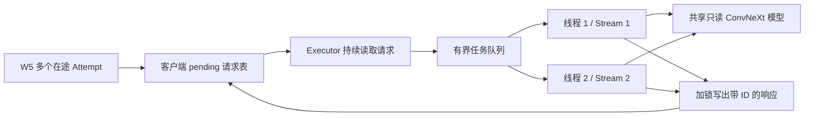

# 多路 GPU 推理调查

调查日期：2026-11-14。对象：当前 DormPool、Windows、RTX 5060 Laptop GPU（约 8GB）、ConvNeXt Small。

## 结论

建议沿用一个常驻 Executor、一个只读模型，增加**有界的任务处理线程与独立 CUDA Stream**，先验证 2 路，再比较 4 路。并行范围应覆盖图片预处理、推理及结果打包；只增加 GPU Stream 无法解决串行 CPU 预处理的问题。

本次已运行独立实验验证这一方向，没有修改生产执行流程、启动额外 Worker 或停止当前 Worker。实验不连接 Master。

单卡多进程可作为强调进程隔离的备选，但不能承诺 GPU 内核并行；原生 Windows 不支持 MPS。动态批处理适合作为后续优化，不能把任务槽位、分片大小、GPU batch 和 Stream 数混为一个参数。

## 当前代码为何仍然串行

| 位置 | 当前行为 | 改造影响 |
| --- | --- | --- |
| `worker/agent/w5_exec.py` / `ExecutionManager` | 仅创建一个 `ResidentExecutor`；多个任务可分别下载、等待、上传 | 一个进程本身可以保留，但需要支持多个请求在途 |
| `worker/agent/executor_client.py` / `execute()` | `_rpc` 锁覆盖发送到等待结果的整个过程 | 目前任意时刻仅一个请求进入 Executor |
| `executor/service.py` / `serve()` | stdin 循环同步执行完整 handler，再读取下一个请求 | 需要读取请求与执行任务分离 |
| `executor/workload/convnext_infer.py` / `run()` | 顺序完成 ZIP 读取、Pillow/NumPy 预处理、整片堆成 batch、推理、CPU 回传和 ZIP 写出 | 没有显式 Stream，也没有独立的 GPU microbatch 上限 |
| `worker/agent/w1_runtime.py` | 强制单槽位的代码目前已被注释 | 增加槽位只会增加在途任务，不能绕过上述两处串行限制 |
| `scripts/start_worker.ps1` | `MaxSlots` 当前默认 100 | 不能把 100 个在途 Attempt 解读为 100 路 GPU 推理 |

现有 `DORMPOOL_TASK_TIMEOUT` 在获得 `_rpc` 锁后等待响应时才生效，不覆盖等待该锁的时间。多路改造需要单独记录排队耗时并限定总等待时间。

## 本机短时实验

环境：`.venv-gpu`，PyTorch `2.15.0+cu132`，本地官方 ConvNeXt Small 权重，FP32，`torch.set_num_threads(2)`；实验额外设置 interop 线程为 1。生产服务目前没有显式设置 interop 线程，因此实验不是生产执行配置的完整复刻。

输入为固定种子生成的 640×480 RGB PNG，包含渐变和噪声。同一 batch 的不同并发设置使用相同输入。模型仅初始化一次，每个执行线程预热后开始计时。每种配置测量两轮，第二轮反转测试顺序。下面列出两轮实测范围，未取“最好一次”作为唯一结果。

| 每个任务图片数 | 并行处理线程 / 独立 Stream 数 | 有效图片/秒 | 每任务 P95，ms |
| --- | --- | --- | --- |
| 1 | 1 | 33.82–35.95 | 33.38–37.80 |
| 1 | 2 | 59.93–80.52 | 33.16–38.13 |
| 1 | 4 | 107.45–109.86 | 48.67–48.90 |
| 4 | 1 | 59.59–61.36 | 73.29–76.99 |
| 4 | 2 | 104.75–108.19 | 82.16–83.16 |
| 4 | 4 | 187.29–209.05 | 97.00–106.65 |
| 8 | 1 | 63.10–67.71 | 130.67–134.51 |
| 8 | 2 | 114.36–118.39 | 146.31–165.44 |
| 8 | 4 | 209.21–214.89 | 219.08–230.09 |

再用 batch=4、多个线程**共用同一个默认 Stream**做对照：

| 处理线程数 | 默认 Stream 数 | 有效图片/秒 | 每任务 P95，ms |
| --- | --- | --- | --- |
| 1 | 1 | 58.74–58.79 | 73.26–73.72 |
| 2 | 1 | 109.18–109.74 | 85.02–87.28 |
| 4 | 1 | 163.65–175.90 | 115.46–117.99 |

这一对照支持：允许多个任务的 CPU 阶段与 GPU 工作交错，本身就有较大收益。独立 Stream 的结果进一步改善，但尚未采集 GPU kernel 时间线，不能把全部吞吐增长归因于 kernel 重叠。

24 个配置轮次均通过同 batch 参考 logits 比较（`rtol=1e-4, atol=1e-4`）与 top1 一致性检查。该检查是本次合成输入的回归验证，不能替代真实数据集上的正确性验收。

独立 Stream 实验中的 PyTorch 峰值活跃 Tensor 最大约 447 MiB，缓存保留约 1018 MiB，整张显卡采样占用约 4503 MiB。整卡占用包含已有 Worker 和其他程序，且该数值不是高频采样得到的峰值；不能据此推算 50 路的容量。

测量局限：每轮仅 1.5 秒（默认 Stream 对照为 2 秒），输入为合成图；测试开始时有现有 Worker，结束时其原 PID 已不在，后台负载与整卡占用并非受控条件，不能将不同轮次的差异视为精确收益。实验也未执行生产服务中的 CuPy 探测。结果包含本地 ZIP/预处理/推理/打包与少量轮末校验开销，不包含 Master、下载、上传和聚合，也不是正式 `P_i`、`P_pool`、`S` 或池化效率。当前 Master 默认分片为 3，表中的 batch=4/8 是候选调优值。

实验脚本：`._tmp/investigate_gpu_concurrency.py`。原始数据：

- `._tmp/gpu-concurrency-20261114-153233/report.json`：独立 Stream，18 个配置轮次。
- `._tmp/gpu-concurrency-20261114-153351/report.json`：默认 Stream 对照，6 个配置轮次。

临时脚本和原始数据位于忽略目录，清理 `._tmp` 后将不保留；上表保存了本次完整配置结果。复现命令：

```powershell
.\.venv-gpu\Scripts\python.exe ._tmp/investigate_gpu_concurrency.py
.\.venv-gpu\Scripts\python.exe ._tmp/investigate_gpu_concurrency.py --stream-mode default --batches 4 --duration 2
```

## 可选方案与适用边界

| 方案 | 优点 | 代价与边界 | 当前建议 |
| --- | --- | --- | --- |
| 单 Executor、多线程、独立 Stream、共享只读模型 | 权重只加载一次；并行 CPU 阶段；同上下文有机会重叠 GPU 工作 | 请求可能乱序完成；一个 CUDA 故障影响全部在途请求；需要流同步和线程安全 | 优先实现，先 2 路验收，再比较 4 路 |
| 单 Executor、动态批处理 | 多个请求合成一个 forward，提高小任务的批量效率 | 有明确的最大等批时间；拆分结果、坏输入与跨 Task 映射较复杂 | 完成有界并行后单独评测，避免一次修改过多变量 |
| 多个常驻 Executor 进程 | 可只重建故障进程；最容易复用现有串行客户端 | 每个进程持有模型、CUDA 上下文和缓存；Windows 下不能据此保证 kernel 并行 | 对故障影响范围要求高时备选；先测 2 个进程的整卡显存和吞吐 |
| Triton 多实例 + dynamic batching | 已有请求调度、实例和批处理能力 | 需要额外服务部署、模型适配与运维；仍须匹配平台和后端支持 | 后续服务化方向，本次无需先引入 |

NVIDIA 文档区分同上下文 Stream 并行与多上下文时间片调度；跨进程并行所用 MPS 仅支持 Linux/QNX。[CUDA 多上下文说明](https://docs.nvidia.com/cuda/cuda-c-best-practices-guide/index.html#multiple-contexts)、[MPS 限制](https://docs.nvidia.com/deploy/mps/latest/when-to-use-mps.html#limitations)。

Triton 的文档也说明多实例与动态批处理收益取决于模型；批处理已经充分利用 GPU 时，更多实例可能主要增加延时。[Triton 调优说明](https://docs.nvidia.com/deeplearning/triton-inference-server/user-guide/docs/user_guide/optimization.html)。

## 推荐改造边界



1. **客户端按请求 ID 分发响应。** `executor_client.py` 中将生命周期锁、短时写入锁与等待结果分离。保留一个 stdout reader，使用 `(generation, request_id)` 查找 Future/Event；校验 `task_id`、`attempt_id`、PID。支持响应乱序。不能直接删除 `_rpc` 锁，让多个线程从同一个消息队列任意取结果。
2. **服务端持续接收，有界派发。** `service.py` 初始化和预热一次后，再创建固定数量的执行线程；队列与线程数均有限制。每个线程绑定自己的 Stream，共享已完成初始化的 `eval()` 模型。响应写入必须加锁。当前逐任务 `redirect_stdout()` 修改进程全局 stdout，并发时会互相干扰，应改成工作负载统一向 stderr 写日志。
3. **正确处理 CUDA 同步。** 每个执行线程进入自己的 Stream 和 `inference_mode()`；跨 Stream 使用 Tensor 时处理依赖及其存活期。模型初始化完成后各 Stream 等待初始化流。避免在热路径调用整卡 `torch.cuda.synchronize()`，结果返回前等待所属工作完成。PyTorch 明确要求非默认 Stream 的调用方负责同步，并说明 `inference_mode()` 是线程局部状态。[CUDA Stream 语义](https://docs.pytorch.org/docs/2.15/notes/cuda.html#cuda-streams)、[inference_mode](https://docs.pytorch.org/docs/2.15/generated/torch.autograd.grad_mode.inference_mode.html)。
4. **分开管理容量。** `MAX_SLOTS` 继续表示 Worker 在途 Attempt 上限；新增执行并行度、GPU microbatch 上限和预取队列上限。建议新增配置默认保持单路兼容，实验比较 2/4 路与 batch=4/8；这些新增配置目前尚不存在。分片是调度和重试单位，不能直接用无限大的分片构造 GPU batch。下载和打包并行也要有 CPU/RAM 上限。
5. **补全超时与背压。** 分别记录领取、下载、入队、开始推理、完成、上传确认时间。租约继续覆盖完整 Attempt。排队必须可超时、可在退出时取消；不能因为 100 个任务已被领取而无限堆积线程和已解码图片。前端分别展示在途任务与执行中的 GPU 路数，避免再次误读槽位。
6. **保留进程隔离。** Agent 仍不导入 torch/CuPy。普通输入错误只失败对应 Attempt；CUDA 致命错误、进程退出或需强制回收的超时，终止整个 Executor generation，并显式失败该 generation 的所有未完成请求，再由 Master 有限重试。Stream 不是进程隔离单元，不能只“重建一个故障 Stream”后假定 CUDA 上下文健康。旧 generation 的迟到响应不得提交到新请求。
7. **保持暂停与退出语义。** 暂停停止领取；已有请求按既定规则完成。退出先停止接收、有限等待，再失败剩余请求、终止和回收子进程。W6 状态应列出 Executor PID、generation、队列长度、并行度和在途请求，不能继续只表现为一个忙闲布尔值。
8. **同步评测来源。** `execution_profile` 应包含执行方式、Stream/线程数、GPU batch、队列设置、精度和相关实现摘要；更改配置后重新预热和测量基线。沿用 M6 的配置一致性检查。同一张 GPU 上的多个 Worker 不能当成多个独立物理设备相加计算正式池化指标。

如果“多路”指多张物理 GPU：优先每张 GPU 一个常驻 Executor，显式绑定设备并记录 UUID。当前 `_load_model()` 只明确处理 `cuda`/`cpu`，直接把 `DORMPOOL_CONVNEXT_DEVICE` 设为 `cuda:1` 并不会按该字符串选择第二张卡。可以通过各独立子进程的 `CUDA_VISIBLE_DEVICES` 绑定，再在进程内使用 `cuda:0`；客户端需要支持独立环境，避免线程间修改全局环境。单卡多 Stream 与多卡设备绑定应分别验收。

## 实施时的验收门禁

- **协议与唯一性：** 并发请求乱序完成时均匹配正确的 Task/Attempt；连续至少 100 个真实任务，权重加载一次、PID 稳定；不串结果、不重复有效计数。
- **正确性：** 使用固定真实数据集，对比相同 batch 的参考输出、输入覆盖、top1 与 logits 容差；不同 batch 的数值变化单独审查。GPU 不可用或执行失败时不回退 CPU。
- **故障恢复：** 注入坏图片、执行超时、CUDA/进程失败与协议断开，验证受影响请求全部收敛，Master 有限重试；暂停不再领取，退出无遗留进程。
- **性能：** 独占或明确记录同卡竞争，固定模型、精度、输入、分片和正确性标准；每配置预热后至少测 30 秒、重复 3 次，比较 1/2/4 路及 batch=4/8。记录完整 Job 有效吞吐、每任务 P50/P95、排队、CPU、整卡显存和 GPU 利用率。短时实验的配置不能直接作为正式基线。
- **并行证据：** 若声称 GPU kernel 同时执行，必须提供 GPU 时间线中的实际重叠；仅线程并行、GPU 利用率上升或吞吐增加不足以证明。
- **容量：** 满负载长测不出现无界队列、持续显存/RAM 增长或 OOM 重试循环；按真实峰值保留显存余量。若更高并行度没有稳定收益，选较低并行度。

本次完成的是实现路径调查和可行性短测。生产多路协议、队列、Stream 调度与上述门禁尚未实施。
