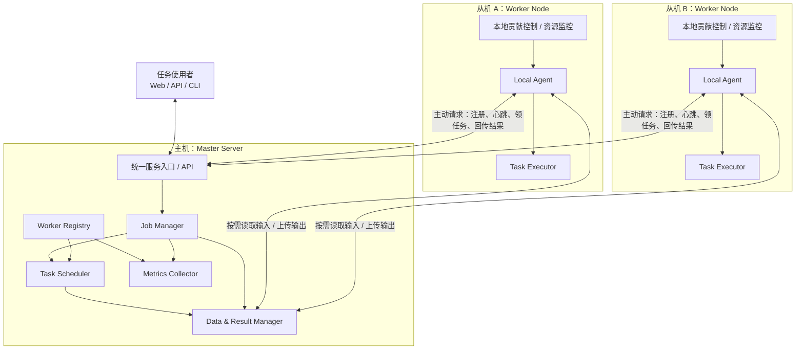
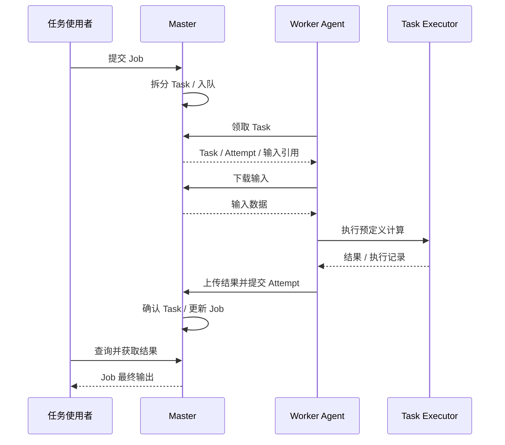
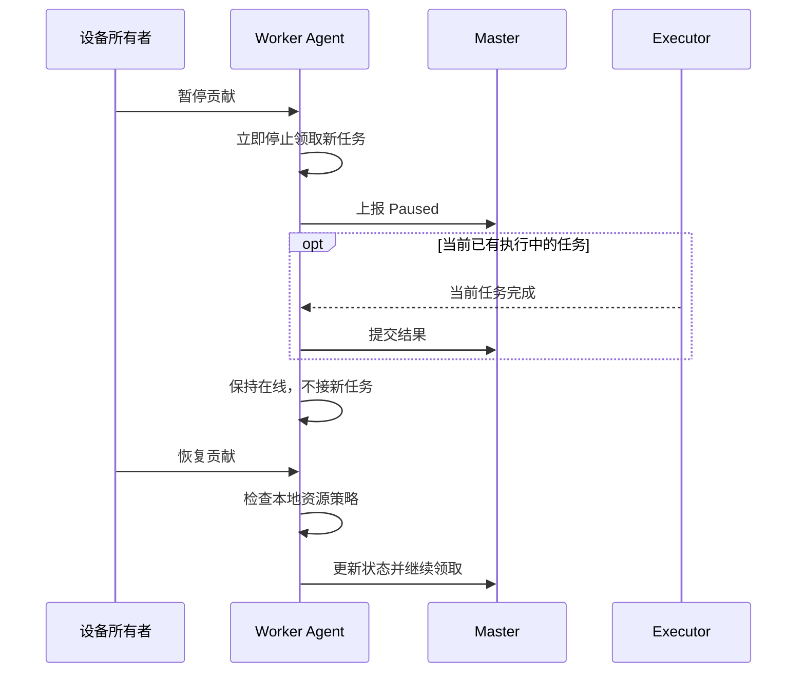
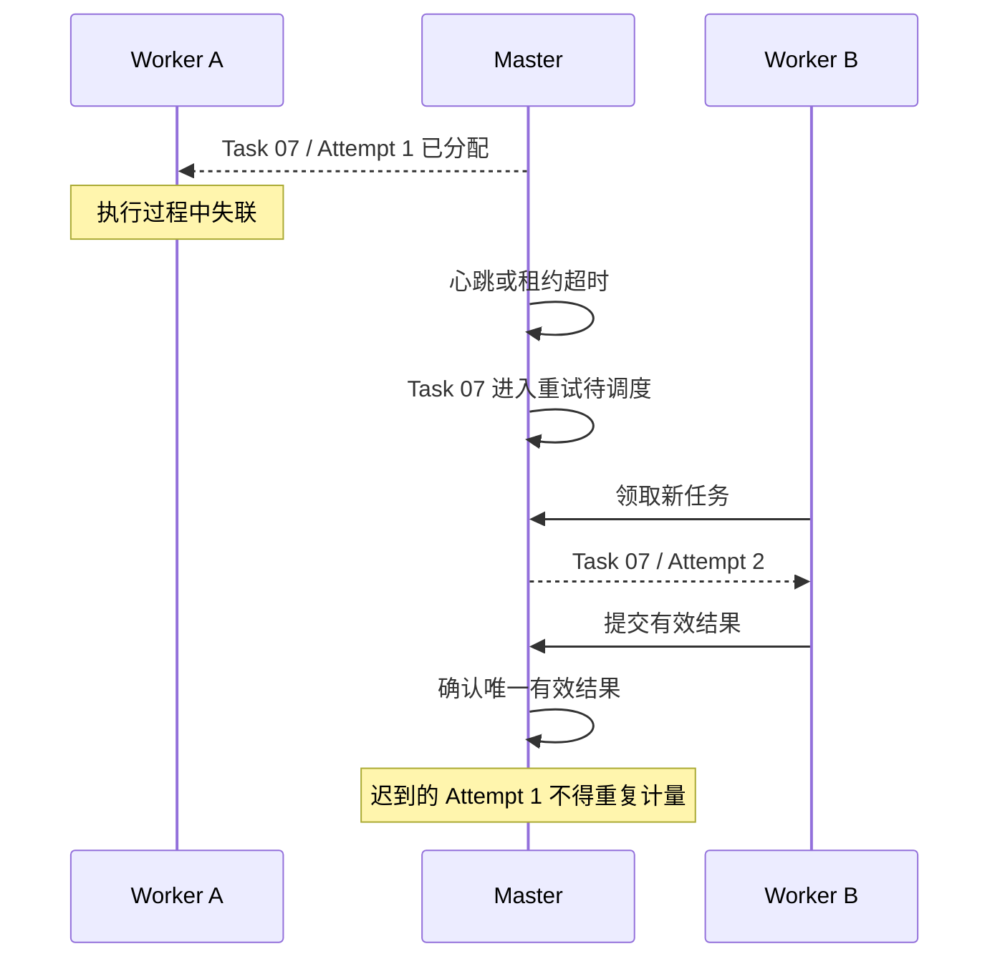
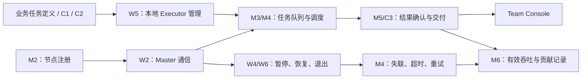

# 方案二：个人优先的弹性团队算力池

## 技术模块设计与系统架构

- **文档版本：** v0.2
- **设计阶段：** 技术架构与模块边界定义（不绑定具体开源框架）
- **项目约束：** 18 小时有效开发；面向约 3–10 人的中小型信任团队
- **总体架构：** 单 Master 协调服务 + 多 Worker 本地 Agent + 预定义 Task Executor
- **工作负载：** 待最终确定；当前以可分片批量计算作为通用假设

---

## 1. 系统目标与架构原则

### 1.1 目标

将团队成员日常使用的个人电脑或工作站组成微型计算服务：任务使用者通过统一入口提交实际计算任务；各 Worker 在设备拥有者许可且本地资源允许的情况下动态领取任务，执行并返回结果。Worker 可运行时加入、暂停、恢复和退出，而 Master 维持任务全局状态与统一结果交付。

### 1.2 架构原则

1. **中心协调：** Master 持有 Job、Task、Attempt 的全局权威状态与调度权。
2. **分布执行：** 计算在独立物理设备上的 Task Executor 中完成。
3. **本地自治：** Worker Agent 管理本机贡献策略、执行并发和本地任务准入。
4. **主动连接：** Worker 主动连接 Master、注册、领取任务并上传结果；不要求对外开放 Worker 服务端口。
5. **任务与执行分离：** Agent 负责通信与控制，Executor 负责计算，单个任务异常不应使 Agent 一并退出。
6. **可验证：** 任务归属、执行尝试、有效结果及设备贡献应能追溯。
7. **限定能力：** 仅执行约定任务类型；不开放任意远程 Shell 或通用代码执行接口。

### 1.3 系统拓扑



> 图中的模块是逻辑组件；18 小时版本无需将每个模块部署成独立网络服务。Master 可以是一个应用进程，Worker 可以是一个 Agent 进程管理一个或多个执行进程。

---

## 2. 部署单元与控制边界

### 2.1 Master Server（主机总机服务点）

部署于团队设备可访问、网络相对稳定的主机。提供唯一对外任务入口，管理所有 Worker 的注册与状态、全局任务队列、结果汇总、基础监控与指标。

**Master 负责：** 全局任务、分配与执行租约、结果确认、用户服务、全局指标。

**Master 不负责：** 接管从机操作系统、远程操作成员桌面、直接覆盖成员本地贡献意愿。

### 2.2 Worker Node（从机本地服务点）

每台从机运行一个本地 Agent，负责从机与 Master 之间的交互，并管理本机执行器。

**Worker Agent 负责：** 启动、注册、心跳、重连、资源采集、贡献策略、任务领取、执行管理、结果回传、本地操作入口。

**Task Executor 负责：** 依据预定义任务契约执行实际 CPU/GPU 计算，输出结果和执行记录。

推荐结构：

```text
Worker Device
├── Worker Agent Service（本地常驻）
│   ├── Master Connector（主动对外连接）
│   ├── Resource Monitor（本地指标）
│   ├── Contribution Controller（贡献策略）
│   ├── Execution Manager（调度本机执行器）
│   └── Local Control Interface（CLI / localhost）
└── Task Executor（独立计算上下文）
    └── 预定义业务计算
```

### 2.3 两种 Master–Worker 通信形态

| 形态 | 操作方式 | 主要代价 | 判断 |
|---|---|---|---|
| **A：Master 主动请求 Worker** | 每个 Worker 开放可访问的网络服务端点；Master 推送任务 | 动态 IP、NAT/防火墙、端口与权限管理更复杂 | 当前不推荐 |
| **B：Worker 主动请求 Master** | Worker 注册、心跳、领取任务、下载输入、上传结果 | 需要轮询/长轮询或持久连接机制 | **推荐基线** |

形态 B 下，本地服务点仍具备独立运行与控制能力。`Master → Worker` 的业务指令可以通过 Worker 主动发起的请求响应返回，不必要求 Master 主动建立网络连接。

本地操作入口仅绑定本机或使用 CLI；成员直接在自己的电脑上暂停、恢复或查看共享状态。

---

## 3. 具体技术模块

### 3.1 Master 侧模块

| 编号 | 模块 | 职责 | 关键技术要点 | 优先级 |
|---|---|---|---|---|
| **M1** | API Gateway | 统一用户/Worker 请求入口、基础身份验证 | 输入校验、请求路由、访问限制、任务查询 | P0 |
| **M2** | Worker Registry | 节点登记与动态状态管理 | 设备 ID、能力声明、心跳、在线/失联、重连 | P0 |
| **M3** | Job Manager | Job 创建、拆分及进度管理 | Job/Task 关联、生命周期、任务终态 | P0 |
| **M4** | Task Scheduler | Task 排队、匹配、分配与故障恢复 | Worker Pull、任务领取原子性、租约、超时、有限重试 | P0 |
| **M5** | Data & Result Manager | 输入数据管理、分发、结果确认与聚合 | 数据引用、完整性校验、结果唯一确认、输出交付 | P0 |
| **M6** | Metrics Collector | 记录真实执行及节点指标 | Attempt 日志、有效单位、设备贡献、测试窗口 | P0 |
| **M7** | Advanced Scheduler | 高级调度优化 | 历史性能加权、自适应批大小、任务优先级 | P2 |

**模块依赖：** `M1 → M3 → M4 → M5` 为任务主链；`M2 → M4` 提供可用资源信息；`M6` 横跨各模块采集记录。

### 3.2 Worker 侧模块

| 编号 | 模块 | 职责 | 关键技术要点 | 优先级 |
|---|---|---|---|---|
| **W1** | Agent Runtime | 本地常驻服务及生命周期 | 启动/停止、配置、运行状态、异常隔离 | P0 |
| **W2** | Master Connector | 与 Master 的通信适配 | 注册、心跳、任务领取、输入下载、结果回传、重连 | P0 |
| **W3** | Resource Monitor | 设备资源与执行占用采集 | CPU/GPU、内存、可用槽位；基础采集 P0、深度监测 P1 | P0/P1 |
| **W4** | Contribution Controller | 决定是否接收更多任务 | 手动暂停/恢复、并发限制、资源准入与策略抖动处理 | P0/P1 |
| **W5** | Execution Manager | 管理本地 Task Executor | 任务输入、执行状态、错误捕获、结果上传 | P0 |
| **W6** | Local Control Interface | 提供设备所有者操作入口 | CLI 或 localhost API、贡献设置、状态查询 | P0 |

**模块依赖：** `W1` 管理 Agent 生命周期；`W2` 负责外部通信；`W3 → W4 → W5` 确定本机资源准入与任务执行；`W6 → W4` 提供所有者控制。

### 3.3 跨端共享的计算与契约模块

| 编号 | 模块 | 职责 | 关键技术要点 |
|---|---|---|---|
| **C1** | Task Contract | 统一 Job / Task / Attempt 数据模型 | ID、状态、归属、任务要求、执行版本 |
| **C2** | Workload Adapter | 将实际业务计算封装为标准执行器 | 固定任务类型、可分片输入、可验证输出 |
| **C3** | Validation & Accounting | 结果验证及有效工作量计数 | 正确性标准、结果唯一确认、防重复统计 |

### 3.4 用户交互模块

| 模块 | 部署位置 | 面向对象 | 最小功能 |
|---|---|---|---|
| **Team Console** | Master | 任务使用者 / 团队管理者 | 提交 Job、查看进度、下载结果、查看节点概况 |
| **Local Control** | Worker | 设备所有者 | 加入、暂停、恢复、退出、查看贡献状态 |

18 小时内建议一个 Master Web 页面与一个 Worker CLI 或极简本地控制页，不需要两套完整管理后台。

---

## 4. 关键数据对象与状态模型

### 4.1 Job / Task / Attempt

| 对象 | 含义 | 关键字段语义 |
|---|---|---|
| **Job** | 用户提交的一次完整业务请求 | `job_id`、任务类型、输入引用、总进度、最终状态 |
| **Task** | 可独立分发的计算单元 | `task_id`、`job_id`、资源要求、输入引用、状态 |
| **Attempt** | 某个 Worker 对 Task 的一次执行尝试 | `attempt_id`、`task_id`、`worker_id`、租约、执行时间、结果状态 |

同一 Task 可能出现多次 Attempt，但**有效工作量只能按通过确认的逻辑 Task 计一次**。

### 4.2 Worker 状态维度

避免将 Worker 简化为单一的“在线/离线”：

| 维度 | 典型状态 | 作用 |
|---|---|---|
| 连接状态 | Online / Offline | 是否可通信 |
| 贡献状态 | Available / Paused / Draining | 是否允许接新任务 |
| 执行状态 | Idle / Busy | 是否有任务执行中 |

例如 Worker 可同时 `Online + Paused + Busy`：已暂停新任务，但仍在完成此前领取的任务。

### 4.3 Job 与 Task 状态

- **Job：** Queued → Running → Completed / Failed
- **Task：** Pending → Assigned → Running → Succeeded；异常时进入 Retry Pending 或 Failed
- **Attempt：** 记录每次执行的实际归属、开始、超时、结束及结果确认状态

需要保证任务不会永久停留在无人负责的执行状态；迟到结果不应覆盖已经确认的有效结果。

---

## 5. 六条跨模块系统链

| 链条 | 起点 → 终点 | 关联模块 | 核心关注 |
|---|---|---|---|
| **L1 节点接入链** | Agent 启动 → Worker 可用 | W1/W2、M1/M2 | 注册、授权、能力、心跳、重连 |
| **L2 任务调度链** | Job 提交 → Task 被领取 | M1/M3/M4、W2 | 分片、排队、匹配、分配、租约 |
| **L3 数据计算链** | 输入上传 → 最终结果交付 | M5、W5、C2/C3 | 数据传输、真实执行、结果完整性 |
| **L4 资源贡献链** | 本地策略/负载变化 → 调度供给变化 | W3/W4/W6、M2/M4 | 手动控制、资源准入、可用性变化 |
| **L5 可靠性链** | 失联/失败 → Task 最终状态收敛 | M2/M4、W2/W5、C1/C3 | 心跳、租约、有限重试、唯一计量 |
| **L6 观测评测链** | 执行记录 → 性能与贡献证据 | W3/W5、M6、C3 | 有效吞吐、资源指标、贡献记录 |

### L1：节点接入链

```text
Worker Agent 启动 → 加载身份与配置 → 主动连接 Master
→ 身份校验 → 注册设备与能力 → 周期性心跳 → 允许领取任务
```

### L2：任务调度链

```text
用户提交 Job → 创建 Job → 拆分 Task → 入队
→ Worker 请求领取 → Master 进行能力匹配
→ 创建 Attempt / 执行租约 → Worker 开始执行
```

### L3：数据计算链

```text
上传原始输入 → Master 保存并建立输入引用
→ Worker 按需获取输入 → Executor 真实计算
→ Worker 上传输出 → Master 验证并汇总 → 用户获取结果
```

### L4：资源贡献链

```text
用户设置贡献策略 / 本地负载变化
→ Agent 判断资源是否允许贡献 → 调整领取行为
→ 上报可用性 → Master 将后续任务分给仍可用的 Worker
```

### L5：可靠性链

```text
Worker 失联 / Task 执行超时 → 检测心跳或租约异常
→ 更新 Worker / Attempt 状态 → Task 重新入队或失败
→ 其他 Worker 执行 → Master 唯一确认有效结果
```

### L6：观测评测链

```text
Worker 执行真实任务 → 上报执行记录 / 资源采样
→ Master 汇总各设备正确完成量 → 对照单机与多机吞吐
→ 计算聚合效率 → 分析瓶颈与个人资源影响
```

---

## 6. Master–Worker 交互契约（语义级）

| 交互 | 网络发起方 | 方向及内容 | 作用 |
|---|---|---|---|
| Register | Worker | Worker → Master：身份、设备 ID、资源能力 | 注册与识别节点 |
| Heartbeat | Worker | Worker → Master：连接状态、贡献状态、正在执行的任务 | 更新状态、检测失联 |
| Claim Task | Worker | Worker → Master：请求任务、能力及空闲槽位 | 主动领取工作 |
| Task Assignment | Master 响应请求 | Master → Worker：任务、Attempt、输入引用 | 告知本次执行内容 |
| Input Fetch | Worker | Worker → Master：请求任务输入 | 下载本次所需数据 |
| Progress / Lease Renewal | Worker | Worker → Master：Attempt 进度与续租 | 维护长任务有效性 |
| Result Commit | Worker | Worker → Master：计算结果、状态、有效工作量 | 完成与确认计算 |
| Local Pause / Resume | 设备所有者 | 用户 → Local Agent：贡献策略变更 | 本地设备自治 |

> 这里的业务响应方向不等同于新建网络连接的方向。例如 Task Assignment 可直接作为 Worker 发起 Claim Task 后的响应返回。

本阶段只固定交互语义；具体使用 HTTP、长轮询或其他机制留待技术选型。

---

## 7. 三条关键系统时序

### 7.1 正常计算任务



### 7.2 个人暂停贡献



基础语义采用 **Graceful Pause**：停止接收新任务，允许已开始任务完成。资源准入增强可在此基础上增加自动暂停/恢复。

### 7.3 Worker 意外失联



---

## 8. 模块间依赖与实现顺序



| 实现序列 | 核心模块 | 最小验收 |
|---|---|---|
| **T1 本地计算闭环** | C1/C2、W5 | 单机对新输入生成正确结果 |
| **T2 节点接入** | M1/M2、W1/W2 | 两台真实 Worker 注册并可通信 |
| **T3 任务分配** | M3/M4、W2/W5 | 两台设备领取并执行不同 Task |
| **T4 结果闭环** | M5、C3、Team Console | 一个 Job 的结果正确返回 |
| **T5 动态自治** | W3/W4/W6、M2 | 热加入、暂停、恢复、优雅退出 |
| **T6 可靠性** | M2/M4、W2/W5 | 失联任务被正确识别并有确定后续状态 |
| **T7 观测评测** | M6、C3 | 输出真实单机/多机、设备贡献和动态实验记录 |

**工程边界：** T1–T4 保证真正的计算服务；T5 体现方案二差异化；T6–T7 提高可靠性与可评测性。

---

## 9. 最终落地形式

### 9.1 两个可独立启动的程序

| 部署程序 | 运行位置 | 内部包含 | 使用者操作方式 |
|---|---|---|---|
| **Master Server** | 固定主机 | M1–M6、统一数据存储、Team Console | 启动总机后，通过统一 Web/API 提交任务和查看状态 |
| **Worker Node** | 每台成员电脑 | W1–W6、Task Executor、Local Control | 输入 Master 地址与授权信息，运行 Agent，随时暂停/恢复 |

不需要把每个功能模块拆分为独立微服务。第一版可以采用“Master 单体应用 + Worker Agent 进程 + Executor 子进程”的工程结构。

### 9.2 最小物理拓扑

```text
                ┌──────────────────────────────┐
用户 ───────────▶│ Master Host / Team Console   │
                │ 调度 / 存储 / 指标 / 状态    │
                └─────────────┬────────────────┘
                              │
                 Worker 主动访问 Master
                         ┌────┴────┐
                         │         │
                 ┌───────▼──┐ ┌────▼───────┐
                 │ Worker A │ │ Worker B   │
                 │ Agent    │ │ Agent      │
                 │ Executor │ │ Executor   │
                 └──────────┘ └────────────┘
```

至少两台独立物理设备需要实际参与有效计算。为了演示清晰，优先使用一台 Master 主机加两台独立计算 Worker；如果 Master 主机同时运行 Worker，仍需保证有至少两台独立物理计算设备实际工作。

### 9.3 本版固定的架构决策

| 决策项 | 推荐基线 |
|---|---|
| 全局控制 | 单 Master 维护任务状态与调度权 |
| Worker 通信 | 主动连接 / 主动领取，不要求 Worker 对外开放端口 |
| 本地控制 | CLI 或仅监听 localhost 的接口 |
| 执行模式 | Agent 与 Executor 逻辑解耦，优先隔离任务异常 |
| 任务模型 | Job / Task / Attempt |
| 数据路径 | 输入输出先经 Master 统一管理与分发 |
| 暂停语义 | 停止领取新任务，已有任务优雅完成 |
| 失联语义 | 心跳/租约失效后重试或进入明确失败状态 |
| 工作负载 | 一个真实、可拆分、可验证的预定义计算任务 |
| 安全边界 | 设备授权、基础鉴权、限定任务类型和输入规模 |

### 9.4 后续需要细化而未在本版绑定的部分

- 实际业务计算类型、输入输出规格与正确性标准。
- Worker 的操作系统、CPU/GPU 组合与统一执行环境。
- Task 粒度、资源需求描述与并发控制策略。
- 数据体量、输入下载/结果上传方式与存储期限。
- 心跳间隔、执行租约时长及重试限制。
- 本地资源保护策略的具体阈值与响应方式。
- HTTP 轮询、长轮询或持久连接的最终通信实现。

---

## 10. 设计结论

整个方案的系统边界可概括为：

> **Master 是团队计算的统一协调服务点；Worker Agent 是个人设备上的本地自治服务点；Task Executor 是实际计算单元。**

最关键的技术闭环是：

**Worker 动态接入 → 本地贡献判定 → 主动领取任务 → 真实计算 → 结果唯一确认 → 状态与指标回传；当本地资源变化或 Worker 失联时，系统重新调整后续任务供给，并保证任务状态可追踪。**

核心开发重点：**动态 Worker 管理、本地贡献控制、可靠任务调度**。其余模块围绕这三个能力提供真实计算、统一体验和可评测的服务闭环。
